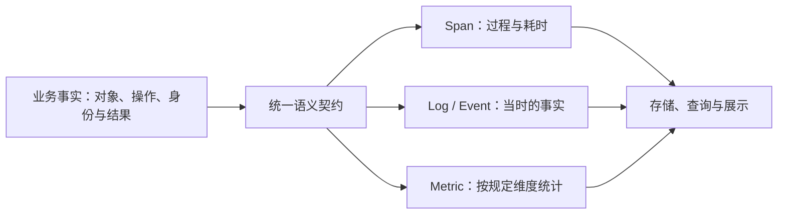

<!-- SUMMARY: N-Agent 可观测权威规范：六项共性原则、业务入口与异步归属、N-Agent 观测统一语义设计、对象/操作/属性/事件/结果/身份与指标、Policy 安全审计、Langfuse 十类观测映射、完成日志、脱敏有界详情、低基数指标与 exemplar、故障隔离、真实 SDK/后端证据和历史数据验收 -->
# 规范可观测行为

观测回答：做了什么、为何结束、哪里慢、消耗多少。“共性规范”和“验收清单”独立于业务领域、项目、语言、框架及后端选型，可直接复用于其他系统；其余章节记录本项目的实现约定。本文是观测规范的权威源，架构、约定、模式及术语文档维护各自边界并引用本文。具体采集行为以对应观测能力启用为前提；本项目业务费用以 Usage 账本为准。

## 共性规范

1. 覆盖完整执行，明确关联归属。观测边界从操作入口延伸至实际完成及必要收尾，不能只有零散子步骤。同步调用准确表达直接父子关系；异步与跨进程操作明确选择延续调用链或建立独立链并记录因果关联。关联上下文与操作归属绑定，在并发、重试和恢复时正确传播、隔离和释放，缺失时明确降级，不借用无关上下文。
2. 信息足以解释，生命周期准确。使用稳定的操作名称和一致的字段语义，保留解释动作、结果和结束原因所必需且允许记录的信息。操作结束前，在对应关联上下文中记录一次完成摘要及相关测量；长连接和流式操作按实际完成、关闭或中断结束。事件模板未注册不应导致有效信息丢失，去除重复或低价值记录时须保留足够的替代信息。
3. 状态与证据真实。区分成功、失败、拒绝、取消、超时和未完成，同时检查异常与返回结果，不用传输成功替代操作成功。未知数值、长度和关联字段保持未知，截断与缺失明确标识。采样记录及指标关联样本不覆盖全部执行，其存在与否不能单独证明链路完整或执行缺失。配置、模拟验证、实际入库和历史完整性分别报告，不伪造结果或补造历史。
4. 数据最小必要，安全与资源有界。按用途选择允许字段并整理成统一结构；敏感内容先脱敏，再按明确的字节预算截断，保留完整性元数据。不同出口分别定义数据权限，使用精确字段白名单，不按命名空间整体放行。指标和索引标签控制基数，不放执行唯一标识或原始载荷。采集、缓冲、排队、传输、重试与清理均设资源和时间上限。
5. 观测故障不改变被观测行为。采集不额外消费数据流，不修改输入输出，不吞掉或改写原有异常和取消语义；观测故障隔离、降级，并保留可用的安全诊断。初始化和释放幂等，资源归属明确，退出在统一总预算内完成必要刷新与清理。部署与迁移先预检，核对实际持久化和保留策略，留存固定样本与回退路径。
6. 分层验证，形成端到端证据。沿“采集 -> 字段整理与脱敏 -> 传输 -> 存储 -> 查询/展示”核对数据、语义与关联的一致性；使用真实组件验证关键接口、生命周期和关联机制，再用实际存储查询证明交付。覆盖正常、失败、取消、并发、采样、恢复和退出场景，测试之间恢复共享状态。服务健康、配置正确或模拟测试通过，均不能代替实际链路及历史数据完整性证据。

## 信号与组件

共享后端使用 `docker/observability/docker-compose.yml`，Compose 项目固定为 `n-observability`。部署/更新：`sh docker/observability/restart.sh`；停止：`sh docker/observability/restart.sh stop`；从旧内嵌后端迁移：`sh docker/observability/restart.sh migrate`（非默认旧项目可传 `--legacy-project`）。观测生命周期入口全部在该目录，业务 `docker/restart.sh` 只管理 Agent/browser。

生命周期操作在 stderr 即时显示阶段进度，Docker 启停输出实时透传；单条命令未结束时每 5 秒提示等待，就绪轮询报告耗时及容器状态，部署完成显示 `compose ps`。内部 JSON 查询保持捕获且不打印展开配置；`compose` 诊断子命令不添加进度文本，保留可供管道处理的原始 stdout。

配置可从同目录 `.env.example` 复制为 `.env`。迁移会核对旧容器真实挂载，复用五个原命名卷和 Pyroscope 三个匿名卷，将八卷映射记录到 `.volumes.json`；该文件须备份，不能丢弃后直接按默认卷名部署。预检失败不改容器/网络/卷；切换失败先停新写入者再恢复旧容器，并清理本次停止残留以允许重试。快照与绑定原卷的恢复override保存在 `locals/harness_tmp/observability-migration-*`，恢复命令见其中 recovery.txt。停止脚本保留数据和网络，禁止使用 down -v。

Agent、Collector、Pyroscope 加入 external bridge `n-telemetry`；后端六服务另有独立私网。应用不直接访问 Prometheus/Loki；诊断命令用 `sh docker/observability/restart.sh compose ...`。Prometheus查询和Loki验证通过观测项目的Prometheus容器执行。Grafana/Tempo/Pyroscope人工访问端口仍只发布到宿主127.0.0.1；不开放宿主OTLP端口。部署脚本重建观测项目以加载只读挂载配置，不触及业务容器。

N-KB 在自身 Compose 中为应用服务追加网络，保留自身原网络及数据库隔离：

```yaml
services:
  n-kb:
    networks: [default, telemetry]
networks:
  telemetry:
    external: true
    name: n-telemetry
```

N-KB 的 OTel exporter 配置指向 `http://otel-collector:4317`（gRPC）或 `http://otel-collector:4318`（HTTP，按其SDK配置路径）；Profile可使用 `http://pyroscope:4040`。保持独立 service.name（如 n-kb），不复制业务方的 COMPOSE_PROJECT_NAME 或观测后端服务定义。共享网络由观测部署入口创建；N-KB首次启动前需确保该网络存在。N-KB专属详情字段仍需其与Collector投影契约对齐。

Pyroscope 使用持久 filesystem bucket `/var/lib/pyroscope` 与 ingester `/data` 双层存储。原 local-only 配置中，168h compactor 保留期不控制本地低磁盘清理；v1.21.1 可用比例计算偏差可能在不足10GiB空间时删除4h前本地块。本次启用 bucket，将低磁盘策略改为有效的非零阈值（1GiB/1%；该版本只接受大于0的覆盖值，不能用0关闭默认策略），保留已上传本地块正常清理与7天bucket保留。迁移发现的一小时旧Profile样本差异及无法恢复的限制记录于 D079，不等同于历史数据全部验证通过。

| 信号 | 用途 | 当前组件 |
|---|---|---|
| Trace | 看一次执行及各步骤的关系、耗时 | OTel → Collector → Tempo |
| Log | 看执行现场、输入输出、结束原因和异常 | 应用 stderr；OTel → Collector → Loki |
| Metric | 看调用量、耗时分布、Token 和失败统计 | OTel → Collector → Prometheus |
| Profile | 找进程内的代码热点 | py-spy → Pyroscope |

Grafana 统一展示。信号模型、Trace 上下文和 OTLP 沿用 [OTel](https://opentelemetry.io/docs/concepts/signals/)；组件选型、打点范围和日志要求属于 N-Agent 约定。默认保留有效信息，经统一脱敏和限长后进入 Log 或 Trace；不能把未注册、超限或中断当作整段丢弃的理由。

## Trace：覆盖执行，过滤噪声

```text
HTTP SERVER（对话请求）
├─ 辅助模型调用（如标题生成，发生时记录）
└─ invoke_agent（一次 Agent 执行）
   ├─ chat（每次真实模型请求）→ 出站 HTTP
   ├─ execute_tool（每次工具调用）→ 工具依赖
   └─ context.compress（上下文压缩）→ 压缩模型调用
```

- 入站 HTTP 只采集 `/chat/completions`、`/v1/chat/completions`，兼容查询参数和尾斜杠。`/static`、页面、健康检查、管理接口和轮询不创建入站 Span。
- 关闭 ASGI receive/send Span。HTTPX/SQLite 自动 CLIENT Span 必须有有效父操作；不为独立后台探测等请求创建孤儿 Span。
- HTTPX/SQLite 由 `build_application_services` 在 SDK 配置后、业务客户端构造前调用 `instrument_clients` 进程级幂等注册，覆盖 HTTP、CLI、ACP；不能只依赖 FastAPI `instrument_app`。禁用观测时不注册；客户端注册失败不阻止独立的服务端中间件安装。E2E 除 Agent Trace 外，逐模型核对 HTTP 子 Span、请求/响应 payload 与完成事件；尚未通过校验的 Trace 持续回读，失败仍保留链接。
- CLI 经 `request.handle -> gateway.handle_message`、ACP 经 SDK 的 `request.handle -> gateway.handle_message`、飞书事件经 `request.handle -> gateway.handle_message`、后台 Task 经 `task.run` 进入 Agent；业务入口 Span 覆盖准入/编排与收尾，不能仅以 `invoke_agent` 存在或有 exemplar 判断入口完整。CLI 单次消息（流式/非流式、REPL 每轮）建立明确入口，不以整个终端会话为边界；继承有效上游上下文，无上游时为根 Span。CLI 与 Gateway 流式 Span 持续到实际消费结束，关闭向内传递；错误事件区分执行失败与取消。CLI 入口复用统一详情能力记录请求、实际输出和失败前缀，不额外创建 ACP 入口。
- 模型调用和工具调用通常是 Agent 下的兄弟，工具不能挂到已结束的模型 Span 下。真实请求尝试各记一次，不重复打点。
- 定时任务在 `ScheduleRunService.run_claim()` 创建 `schedule.run` 入口 Span，覆盖策略检查、执行记录、Agent 与投递；自动触发和手动运行复用该入口。Agent Span 继承其上下文，投递发生在 Agent Span 结束后、定时任务 Span 结束前。记录 task/claim/session 标识、执行与投递状态及完成摘要；任务 prompt 与执行结果通过统一详情通道先脱敏再限长，不进入普通属性、指标或自检缓冲。
- Task 的 `task.run` 包含 worker/Judge 多轮、终态处理及通知。有明确上游的任务，首次执行、自动重试和进程恢复均复用上游 Trace ID，各 Run 创建不同 Span；对话、CMD、API、人工点击、定时触发统一适用。创建时持久化服务端捕获的 traceparent，每次 Run 从该 carrier 恢复直接父级，不继承领取 tick，也不因重试改写上游。`POST /chat/tasks` 创建 `task.submit` 入口并提取远程 traceparent；独立 CLI 创建命令使用 `request.handle` 和 application_runtime 收尾。仅缺少或无效上下文的任务可以建立根 Trace，必须用 `nagent.task.trace_context=missing|invalid` 显式标记；正常继承为 `inherited`。历史 Trace 不补造。
- `skill.review`、`curator.run` 使用独立 Trace + Link；Curator 内部 review 保持同 Trace 的父子关系。后台独立操作清理继承的业务现场并在退出时恢复；`clear_run_context()` 本身只清理业务 ContextVars，不代表 OTel Trace 已隔离。
- 委派按所属 delegation 的服务端 traceparent 恢复到 `delegation.run_member -> invoke_agent`，禁止继承领取 tick 的偶然父级。原始关联随创建事务持久化，重连不覆盖；旧记录、损坏值或关联读取失败创建独立 member 业务根。保留未采样标志，不将 baggage/正文/凭据持久化。固定 source 映射包含 `delegation`。
- 应用入口统一由 `business_operation` 管理完成摘要、失败/取消状态和现场恢复；仅接受固定操作名及标识白名单，不新增高基数指标标签。Tracer 故障回落到有效构造的非记录 Span，不阻断业务。CLI Curator run 通过 `application_runtime` 在成功或异常退出时收尾导出。
- 每个业务入口自身记录本次请求与实际结果，不能用子 Agent/模型已有详情替代。Gateway、Task、Schedule、委派与后台审查统一使用 `details.input_messages/output_messages/error` 等既有白名单字段，经 `project_details` 投影后交给入口作用域的 `facts["details"]`；完成时同一份信封进入该 Span 和关联完成日志。流式结果沿消费路径有界收集，避免 delta 与最终消息重复计数，关闭/失败保留安全前缀并标明 incomplete；不得提前消费流。拒绝、跳过等无 Agent 输出的路径记录实际返回状态，不伪造回复。
- Curator 入口的请求详情包括运行参数、有效整理开关/阈值和候选技能事实，结果详情包括实际返回结构、已完成迁移计数、模型整理结果/工具调用及错误；不得只存 summary_so_far。迁移完成时立即保存观测事实，后续报告失败或取消不将已完成计数重置为零，未完成结果标记 incomplete。所有入口验收须断言真实内容与异常分支，只有字段存在不算 payload 完整；短输出验证脱敏，超长输出另验截断。
- 同一同步执行链中的 HTTP、Agent、工具和依赖继承同一 Trace；独立后台工作的关联按上述 Link 规则处理。SSE 断连后继续执行的 Agent 保留原关联，不另建 Trace。
- 谁开启 Span，谁负责结束；完成日志和关联指标先记录，再结束。异常、拒绝、取消分别表达，不伪装成功。

## 追踪外部记忆

- `ExternalMemoryManager` 在实际调用 provider 时创建 `memory.prepare_prompt/prefetch/sync/pre_compress/execute_tool`，探测由 `ExternalMemoryProviderService` 创建 `memory.probe`。provider 名限定 builtin、multi-project、mem0、honcho、holographic，其余归 other；沿用业务 source/session，不新增指标标签。禁用、策略拒绝及熔断跳过不伪造 provider 已调用。
- mem0/Honcho 共用的 urllib 客户端通过 `observability/urllib_capture.py` 复用 HTTPX 的安全目标投影、完成日志、详情脱敏与限长；每次实际请求仅有一个 CLIENT Span，覆盖 open、实际读取及 close，注入当前 CLIENT 的标准传播上下文。保留原 URL 安全检查、timeout、响应大小限制和异常语义；无有效父操作时不创建 HTTP 孤儿 Trace。
- mem0 预取线程在启动处复制 ContextVars，在线程内以 `memory.search` 覆盖完整搜索；调用方等待到期记录 timed_out，后台搜索继续归属原调用链，不能继承后续请求的上下文。后台结果为空、后台失败与等待超时分别记录；缓存复用不伪造新的 HTTP 调用。
- Honcho/mem0 自动召回与同步内部捕获的异常同步标记当前 memory 操作失败，工具的 `success=false` 同样标为 failed；保持原有空结果、返回值和异常隔离。sync 的结果只记录方法已返回，不声称远端异步记忆已完成持久化。
- Holographic 的本地 SQLite、builtin 和 multi-project 文件记忆复用公共操作 Span；不伪造 HTTP 调用。请求、召回内容、工具参数与结果仅走统一 details 通道；Honcho workspace/peer/conclusion ID 在 HTTP 路径中模板化。

## 串联 N-Agent 与 N-KB Trace

双方使用 [W3C Trace Context](https://www.w3.org/TR/trace-context/)，通过 HTTP 请求头传播，不修改知识检索 JSON 或响应。N-Agent 由现有 OTel HTTPX 自动埋点先激活 CLIENT Span，再调用全局 propagator 注入；Knowledge adapter 不重复 inject 或创建 CLIENT Span。部署须保持 tracecontext 启用，不使用 `OTEL_PROPAGATORS=none` 或仅 baggage；项目不覆盖全局传播器配置。

```text
invoke_agent（N-Agent）
└─ execute_tool search_knowledge
   └─ HTTP CLIENT POST /retrieval/search（N-Agent）
      └─ HTTP SERVER POST /retrieval/search（N-KB）
         └─ 检索、重排、模型和数据库等内部 Span
```

例如 `traceparent: 00-4bf92f3577b34da6a3ce929d0e0e4736-00f067aa0ba902b7-01`：32 位 trace-id 沿链不变，16 位 parent-id 是 N-Agent 本次 HTTP CLIENT 的 Span ID，flags 最低位表示 sampled。有效的可选 `tracestate` 随标准传播器传递，由 SDK 按规范管理。未采样但有效的上下文仍传播，不能以 `is_recording()` 判断上下文有效性；baggage 是独立机制，本次不新增业务 baggage。

### N-KB 独立实施契约

- 将 `POST /retrieval/search` 纳入入站自动埋点，只创建一个 SERVER Span。不能直接复制 N-Agent 仅采集对话入口的路由过滤，否则检索入口被排除。
- 创建 SERVER 前提取 `traceparent/tracestate`，使用远程上下文作为父级。SERVER 的 trace_id 等于 N-Agent CLIENT 的 trace_id，parent_span_id 等于 CLIENT 的 span_id；检索内部 Span 继承 SERVER。使用对应框架 OTel 埋点，避免手工解析或拼装 ID。
- 使用 ParentBased 采样继承上游决定；无头或 traceparent 无效时按标准创建本地根，不改变检索响应。不用自定义 X-Trace-ID 代替标准父上下文，不以 Trace ID 授予业务权限。
- 使用独立稳定的 `service.name`（建议 `n-kb`），两端汇入同一可查询 Trace 后端，可通过不同 Collector 汇入同一 Tempo；不要求相同语言或 SDK。
- 日志关联当前 trace_id/span_id；N-KB 仍需独立配置日志导出和后端关联。查询、文档正文、凭据不得进入 tracestate/baggage。观测故障不影响业务；异常、取消和请求结束释放上下文，并发不能串链。
- N-Agent 无有效父操作的独立管理 probe 保持降噪，不产生 CLIENT Span/传播头；N-KB 可按自身策略创建本地根，这是预期的独立探测链路。

### 验收边界

`tests/infrastructure/observability/test_nkb_trace_propagation.py` 沿真实 adapter 和生产全局 HTTPX 注册路径，验证请求头、唯一 CLIENT、模拟远程 SERVER 父级、tracestate、采样开关、并发、无父 probe、未注册埋点调用及 HTTP 错误。接收端从空 Context 提取，避免同进程 current context 造成假阳性。这仅证明 N-Agent 出站契约，不代表真实 N-KB 已接通。

双端完成后，从 N-Agent Chat 调用已注册 N-KB，在 Tempo 检查同一 Trace 的两种 service.name 和直接父子关系，再按 Trace ID 查两端日志。未采样场景检查传输头与接收上下文，不要求后端存在 Span。另测无效/缺失头创建本地根，以及错误/取消后新请求不继承旧上下文。人工清单见 `.harness/specs/verify/verify-261029-link-nkb-traces.md`。

## Log：根 Span 有完成日志，业务日志带现场

| 位置 | 完成日志 | 内容 |
|---|---|---|
| HTTP SERVER Span | `nagent.http.completed`，每请求一次 | 方法、路由、状态码、耗时、结果；显式关联该 HTTP Span |
| HTTPX 出站 Span | `nagent.http.completed`，每次传输一次 | 目标主机/端口、脱敏路由模板、代码调用位置、方法、状态、耗时、结果；同时写入该 Span 的 Events 和同 Span ID 的 Log |
| Agent 执行 | `nagent.agent.completed` | 结束原因、消息数、模型/工具调用数、Token、耗时、可读摘要 |
| 模型和工具 | `nagent.model.completed` / `nagent.tool.completed` | 当前模型/工具、调用结果、用量/策略、耗时、可读摘要与详情 |
| 上下文压缩、预算拒绝 | `nagent.context.completed` / `nagent.budget.denied` | 压缩前后 Token、耗时、结果与异常；预算拒绝的类别及现场 |

入站 HTTP 流式响应在最终响应体发送后记录完成日志；取消或异常保持真实结果，尚未发响应时不伪造状态码。日志不依赖 Trace 是否采样。补齐日志仅对新请求生效。

出站请求不能只显示一个 GET/POST：名称带方法、目标主机和脱敏路由模板，`nagent.http.caller` 标明应用模块与函数。路径按段处理，保留资源、动作和版本等结构词：`/internal/catalog/status` 原样保留，`/users/alice/messages/123` 变为 `/users/{id}/messages/{id}`。数字、UUID、长十六进制以及用户/文件/会话等资源后的标识模板化；凭据字段后的值、已知密钥和无法安全识别的片段替换为 `{redacted}`，不再抹掉整条未知路径。先解码再判断，模板最多 512 字符。

HTTP 的实际请求与响应写入 `details.http_request/http_response`，包含正文、非敏感查询参数和头；Authorization、Cookie、API Key 等值单独遮盖。HTTPX 按业务实际读取的数据采集，响应读完、关闭、失败或取消后才结束 Span 和完成日志，不为观测预读或消耗流。支持 JSON、文本、表单、SSE、gzip/deflate；multipart 保留文本字段和文件元信息，二进制保留类型与大小。管理写请求即使不创建 Span，也须留下访问日志；静态资源、健康检查和普通管理查询继续降噪。

业务日志默认携带当前可用的上下文和脱敏详情，不能只剩一句事件码：

- 执行现场：会话、请求、入口、当前操作、轮次、模型/工具、消息数、策略与结果等；只填当前阶段实际已知的字段。
- 正文与异常：应用日志默认恢复可读正文，未注册日志使用 `application_log`；普通库日志使用 `library_log`，库的 WARNING/ERROR 使用 `diagnostic_log`。统一脱敏、限长，不因模板未注册而吞掉有效文字和异常堆栈。脱敏器尚未就绪时才退回事件码。
- 详情：Agent 的用户消息与最终回复；模型的实际输入、系统提示词、工具定义和输出；工具的参数与结果；发生错误时的错误详情。
- HTTP 访问日志带自身的请求/响应详情，不继承最后一个子操作的详情。`LogRecord.extra` 的业务字段经投影写入 `details.log_fields`，不能覆盖受信的 Trace/会话身份；不支持的值显示类型说明，不拖累整段有效字段。

实时现场通过 ContextVar 传播，进入子操作时更新，退出时恢复；并发会话不能串号。日志关联发出时活跃的 Span，不把子日志同时挂到全部祖先。

事件按价值治理：

- Policy 审计使用固定模板 `policy_decision %s`，事件为 `nagent.policy.decided`；策略事实经独立 ContextVar 脱敏后输出为 `nagent.policy.*` 字段；身份仅取受信执行快照。不把动态 JSON 注册为模板，也不逐条注册日志正文。
- 启动、迁移、TaskRunner 等稳定业务事件继续注册模板，便于分类；注册不是输出可读日志的前提。
- 仅过滤已被结构化事件替代的 HTTPX/HTTPcore 普通 INFO、Lark 连接成功与 OPA 注册噪声，以及观测自流量。其他有效应用/库日志默认保留；带上下文但没有内容的占位仍过滤。
- WARNING/ERROR 保留来源、级别、当前安全上下文、脱敏正文和异常；外部已有日志 handler 的配置不改写。Profile 失败保留脱敏诊断；导出器失败日志只进 stderr，避免递归进入故障中的导出管线。

### 治理 HTTPX unknown 日志

HTTPX 原始请求返回日志不是模型返回内容。它通常在传输 Span 退出后发出，既可能落到父 Span，也可能因模板未注册而变成 `log_event_unknown`，不能用它代表出站请求完成。

| 情况 | 处理规则 |
|---|---|
| HTTPX 原始 DEBUG/INFO 只有 unknown 与继承的上下文 | 过滤；不为消除 unknown 批量注册第三方模板，不放开原始 URL |
| 有效父操作中的出站请求 | 在自身 Span 结束前各写一次 `nagent.http.completed` Event 与 Log，携带目标、脱敏路径、调用位置、状态、耗时和结果 |
| HTTPX WARNING/ERROR 或有实际详情的诊断 | 默认保留脱敏正文与异常；稳定事件名可补注册，不以未注册为由折叠内容 |
| 无有效父操作的普通请求、观测后端自流量 | 沿用降噪规则，不为补日志而创建孤儿 Span 或递归记录导出请求 |

过滤重复日志必须同时保证替代信息完整：不能留下只有 GET/POST、没有用途、Event 和 Log 的空壳 Span。出站完成日志带实际 HTTP 请求/响应；模型完成日志另有归一化的 `details.output_messages`。未采样时仍保留完成 Log；CLI 使用临时语义/HTTP 日志桥而不污染交互输出；历史 unknown 不回写。

验收须检查同一请求的 Span、Event、Log 是否关联同一个 Span ID，静态路径是否可读、动态片段和凭据是否遮盖，以及失败、取消、未采样与日志故障是否保持业务行为。实现依据见 `tests/infrastructure/observability/test_http_client_observation.py`、`test_log_event_governance.py` 与 Collector 配置测试。

## 详情：先脱敏，再限长

- 只接受固定详情字段，经 `project_details` 投影。凭据、Cookie、密钥和媒体数据先遮盖，字符串键和值再统一脱敏，最后按 UTF-8 限长。
- Loki `limits_config.max_line_size` 显式为 144MB：按 12 个详情项、message/exception.message 各 1 份和两类 stack 各 4 份的预算，共 22 × 1024000 × 6 = 135168000 字节（JSON 最坏转义），另留信封及上下文余量，防止应用上限提高后整条日志被下游丢弃。Collector 在组装 JSON 行后清空 N-Agent/N-KB attributes，正文不进入 structured metadata，因此不扩大该独立预算。此行上限适配默认正文预算；人工上调正文预算时需同步审查下游行预算。
- `N_AGENT_OTEL_CONTENT_MAX_BYTES` 默认每项 1024000 字节；限制单项 `content`，不是整条日志。元数据保留 `original_bytes`、`truncated`，必要时带 `incomplete/observed_bytes`；未知长度保持未知。
- Tempo 2.9 的 `distributor.max_attribute_bytes` 显式设为 `0`，关闭其默认 2048 字节的 Span/Event 属性二次截断；正文预算与完整性元数据由应用投影统一生成。后端截断不会改写应用的 `*_truncated`，验收须同时核对生效配置和入库内容的 UTF-8 长度/摘要。整批接收与整条 Trace 的拒绝预算仍独立生效，不能把单项正文预算当作整条 Trace 的容量保证；已经入库的缺失正文不会因改配置恢复。依据：[Tempo 2.9 截断条件](https://github.com/grafana/tempo/blob/v2.9.0/modules/distributor/distributor.go#L701-L730)。
- Trace 传输按 12 × 1024000 × 2（Span 与完成 Event）= 24576000 字节正文加信封预算：Collector 与 Tempo 的 OTLP gRPC 接收显式为 32MiB，Tempo 内部 gRPC 收发、querier frontend worker 发送及 `overrides.defaults.global.max_bytes_per_trace` 同为 32MiB；Collector OTLP HTTP 接收为 160MiB，承接 JSON 最坏六倍转义。避免原默认 4MiB OTLP、5MB Trace、16MiB 内部发送拒绝合法详情。此预算保障单个上述规模的 Trace，不保证任意多个满载 Trace 合批或任意长多 Span Trace；队列、批次数和内存限额继续独立约束。配置提升后必须用原失败合批与完整单 Trace 回读验证，不以分批避开实际拒绝。
- Tempo `overrides.defaults.ingestion.burst_size_bytes` 同设为 32MiB，允许单次合法信封通过令牌桶；持续 `rate_limit_bytes` 保持默认 15000000 字节/秒。默认 20000000 字节 burst 即使令牌已回满也不能接受 24576000 字节的正文信封，等待或仅提高接收限制都无效。
- 流式内容有界累积；超限、失败或取消时保留已脱敏的可读前缀，标注 truncated/incomplete/observed_bytes；无法得知完整脱敏长度时 original_bytes 保持未知。跨分片凭据和未闭合密钥值也须遮盖。
- `max_tokens`、`input_tokens` 等数值配置/计数不是凭据，不遮盖。Anthropic 初始工具输入同样保留并脱敏，不因非空而丢弃整次输出。
- 脱敏或投影不可用时给出明确说明。业务 Span 与自动 HTTP Span 可通过同一详情通道携带正文；Metric、Profile、最近 Span 缓冲不带正文。DB Span 保留操作和表名，不采集原始参数。

## N-Agent 观测：统一语义设计

统一语义设计先回答“观察谁、做什么、发生了什么、结果怎样、如何关联”，再规定字段和测量。Span、Log/Event、Metric 使用同一套含义，采集、导出、存储和查询沿用这套定义。

语义内容以本节为权威。面向外部的文章与语义附录同步维护对象、操作、属性、事件、结果、身份、指标和内容出口边界；示例可以精简，字段含义、枚举、统计范围与实现状态保持一致。变更任一项时，同时核对规范、文章正文和附录。

### 整体模型

| 概念 | 回答什么 | 示例 |
|---|---|---|
| 观测信号 Signals | 用哪类数据观察系统 | Trace 看执行链，Log 看现场，Metric 看统计，Profile 看代码热点 |
| 记录结构 Fields | 一条记录自带哪些基本部分 | Span 的名称、时间、状态、父级和事件；Log 的时间、级别和正文 |
| 观测对象 Objects | 描述谁 | Agent、模型、工具、任务、请求 |
| 操作分类 Operations | 对这个对象做什么 | invoke_agent、execute_tool、task.run |
| 观测属性 Attributes | 有哪些具体事实 | 工具名、Agent 来源、处理结果、耗时 |
| 事件 Events | 某个时刻发生了什么 | 工具处理完成、策略作出决定、预算拒绝 |
| 状态 State | 对象当前处于哪一步 | Task 正在运行、等待审批 |
| 结果 Outcome | 本次操作怎样结束 | success、denied、cancelled |
| 关联身份 Identity | 属于哪个实例、哪次运行、哪条链 | 会话 ID、AgentRun ID、TaskRun ID、Trace/Span ID |
| 指标 Metrics | 如何统计多次观测 | 运行数、耗时分布、Token 增量 |



例如一次 `read_file` 工具调用：对象是 tool，操作是 execute_tool；Span 名可以是 `execute_tool read_file`，属性记录工具名、所属 AgentRun 和工具自己的结果；结束时记录 `nagent.tool.completed`，并测量一次 `gen_ai.execute_tool.duration`。Metric 只使用该指标允许的维度。

Profile 当前按服务和进程采样，使用 py-spy → Pyroscope；尚未接入 OTel Profiles。

### 记录结构 Fields

| 记录 | 常用结构字段 | 说明 |
|---|---|---|
| Span | Trace ID、Span ID、父 Span ID、name、kind、开始/结束时间、status、events、links | 标识当前步骤、父子关系、操作名称、调用方向、耗时、状态及关联事件 |
| Log | 时间、严重程度、正文、Trace ID、Span ID | 记录当时发生的事实，并关联执行步骤 |
| Metric | 名称、说明、单位、数据点、exemplar | 记录计数或分布；部分数据点可关联到具体 Trace |
| Resource | attributes | 记录数据来自哪个服务实例 |
| InstrumentationScope | 名称、版本 | 记录由哪套埋点产生 |

Resource 保存服务身份信息：服务叫什么、运行哪个版本、具体是哪一个实例。InstrumentationScope 说明由哪套埋点产生数据。业务对象和运行身份通过下文的属性记录。

### 观测对象 Objects

对象是统一命名词汇。属性描述的事实属于谁，就使用谁的对象名；不同步骤可以携带同一个 AgentRun 身份，各自记录自己的结果。

| 对象 | 描述什么 | 主要事实 |
|---|---|---|
| agent | 一次 AgentRun | 来源、运行 ID、轮次、结束原因、范围内调用数和用量 |
| model | 一次模型请求尝试 | 模型、消息数、Token、用量是否已知、结束原因 |
| tool | 一次工具请求的准入与执行 | 工具名、审批状态、风险、是否实际执行 |
| context | 一次上下文压缩 | 压缩前后 Token、本次压缩的结果 |
| task | 任务及一次 TaskRun | 任务 ID、TaskRun ID、业务状态、恢复的关联 |
| delegation | 一次委派成员执行 | 委派 ID、成员 ID、角色 |
| schedule | 一次定时任务领取、执行和投递 | 任务 ID、领取 ID、投递状态 |
| memory | 一次记忆操作 | 操作、Provider、处理结果 |
| skill | 一次后台技能审查 | 审查操作及结果 |
| curator | 一次技能整理 | 整理操作及结果 |
| gateway | 一次网关消息处理 | 消息处理操作及结果 |
| request | 一次入口请求 | 渠道、请求 ID、处理结果 |
| http | 一次 HTTP 传输 | 调用位置、server/client 方向、方法、状态码及耗时 |
| budget | 预算类别及拒绝事实 | 预算类别 |
| policy | 一次策略决定 | 策略、版本、决定种类、原因、决定结果和作用域 |
| observation | 观测过程自身的诊断 | 观测降级或投影错误 |
| metric | 指标采集自身的状态 | 超出基数限制后的归并标识 |
| content | 脱敏且有界的内容详情 | 正文及长度、截断、中断信息 |

CLI、ACP、飞书等记录在 request.channel；request 用于入口请求。context 专门描述压缩；各操作的 summary、outcome、duration_ms 归所属对象。summary 保存本次操作的完成摘要，记忆或上下文的正文走内容通道。

### 操作分类 Operations

标准操作名写入 `gen_ai.operation.name`。自定义操作名称使用 `<object>.<action>`，动作写入 `nagent.<object>.operation`，例如 `task.run` 对应 `nagent.task.operation=run`。模型名、工具名、记忆 Provider 等受控名称可以附在 Span 名后，唯一 ID 和正文不进入操作名称。

| 标准 / 自定义 | 操作名称 | 对象 | 记录什么 |
|---|---|---|---|
| 标准 | `invoke_agent` | Agent | 一次真实 AgentRun |
| 标准 | `chat` | 模型 | 一次模型请求；每次重试分别记录 |
| 标准 | `execute_tool` | 工具 | 一次工具请求，包括拒绝或执行失败 |
| 自定义 | `context.compress` | 上下文 | 一次压缩处理 |
| 自定义 | `task.submit`、`task.run` | Task | 提交任务、后台执行任务 |
| 自定义 | `delegation.run_member` | 委派 | 执行一个委派成员 |
| 自定义 | `schedule.run` | 定时任务 | 一次领取、执行和投递 |
| 自定义 | `memory.prepare_prompt`、`memory.prefetch`、`memory.sync`、`memory.pre_compress`、`memory.execute_tool`、`memory.probe`、`memory.search` | 记忆 | 实际发生的装配、读取、同步或工具操作 |
| 自定义 | `skill.review` | 技能 | 后台技能审查 |
| 自定义 | `curator.run` | Curator | 一次技能整理 |
| 自定义 | `gateway.handle_message` | 网关 | 处理一条网关消息 |
| 自定义 | `request.handle` | 请求 | 处理入口请求；API、Dashboard、CLI、ACP、飞书由 channel 区分 |

API/Dashboard 的 request.handle 事实复用原 HTTP SERVER Span，携带实际 channel；HTTP/DB 沿用自动埋点的名称。未知操作记录 `nagent.observation.error=unknown_object`，保留安全日志和已知关联。

操作分类和属性可用于 Span、Log/Event 和 Metric。每个指标明确选择允许的维度，执行 ID 和正文不作普通指标标签。

### 观测属性 Attributes

项目属性使用 `nagent.<object>.<attribute>` 三段命名，对象和属性使用小写 snake_case。OTel 已有且满足用途的标准属性保留原名，如 service.name、gen_ai.request.model、gen_ai.conversation.id。

下表记录本项目当前使用的字段。GenAI 依据为 `semantic-conventions-genai main @ 2026-10-24 (Development)`，该日期记录现有契约，标准升级需单独核对。允许的字段按实际事实采集，缺失的身份省略。

属性类型由同一份契约校验：ID 和文本使用字符串，计数使用非负整数，bool 只用于布尔事实；耗时为有限非负数，模型结束原因保留字符串数组。类型错误的属性省略，业务继续处理。

| 分类 | 对象或操作 | 属性名 | 类型或含义 | 所在位置及采集边界 |
|---|---|---|---|---|
| 通用标准 | 服务实例 | `service.name`、`service.version`、`service.instance.id` | string；服务叫什么、运行哪个版本、具体是哪一个服务实例 | Resource，随 Trace/Log/Metric 提供；N-Agent 与 N-KB 身份独立 |
| 通用标准 | HTTP server/client | `http.request.method`、`http.response.status_code`、`http.route` | string/int/string；方法、实际响应码、路由模板 | HTTP Span 和完成 Log/Event；无响应不伪造状态码 |
| 通用标准 | 出站 HTTP | `server.address`、`server.port`、`url.template` | string/int/string；请求对方的地址、端口、路径模板，如 `/sessions/{session_id}` | HTTP Span、Log/Event，路径中的实际 ID 等已替换 |
| 通用标准 | HTTP/DB | `http.method`、`http.status_code`、`http.scheme`、`net.peer.name`；`db.system`、`db.system.name`、`db.operation`、`db.operation.name`、`db.collection.name` | 自动埋点锁定版本允许的新旧标准字段 | 精确白名单；不记录原始 SQL/参数，不作为新增项目字段命名依据 |
| 通用标准 | 错误/异常 | `error.type`；`exception.type`、`exception.message`、`exception.stacktrace` | 安全错误类别、脱敏异常文本和堆栈 | 各出口单独审核；不把拒绝或取消自动当作技术错误 |
| GenAI 标准操作 | Agent/模型/工具 | `gen_ai.operation.name` | `invoke_agent` / `chat` / `execute_tool` | Span、完成 Log/Event；工具正常、拒绝和异常均显式设置；不把自定义动作写入此标准键 |
| 项目自定义 | 自定义操作所属对象 | `nagent.<object>.operation` | string；该对象执行的动作，如 task 的 run | 具体值见操作分类表；HTTP 保留自动埋点的请求名称 |
| GenAI 标准 | 模型 | `gen_ai.provider.name`、`gen_ai.request.model`、`gen_ai.response.model`、`gen_ai.request.stream` | string/string/string/bool；Provider、请求/实际响应模型、流式 | 模型事实；响应模型只在已知时记录，指定指标只用允许维度 |
| GenAI 标准 | 会话/Agent | `gen_ai.conversation.id`、`gen_ai.agent.name` | string；会话身份、Agent 名称 | Span/完成日志中的受信关联；会话 ID 不作普通指标标签 |
| GenAI 标准 | 工具 | `gen_ai.tool.name`、`gen_ai.tool.type`、`gen_ai.tool.call.id` | string；工具名、类型、实际调用 ID | 工具 Span/完成事实；调用 ID 不作指标标签 |
| GenAI 标准 | 模型/Agent | `gen_ai.usage.input_tokens`、`gen_ai.usage.output_tokens` | int；已知用量 | 模型及 Agent 汇总分别计算，未知不伪造零 |
| GenAI 标准 | 模型/Token | `gen_ai.response.finish_reasons`、`gen_ai.token.modality` | string[]/string；模型结束原因、Token 模态 | 前者与 Agent end_reason 分开；后者仅指定 Token Counter 维度 |
| 项目自定义 | Agent | `nagent.agent.source`、`nagent.agent.run_id`、`nagent.agent.iteration` | string/string/int；本次 Agent 执行来源、真实 AgentRun ID、轮次 | 受信绑定后可随模型/工具子步骤继承；尚无 Agent 归属时省略；不使用 TaskRun 或请求 ID 冒充 |
| 项目自定义 | Agent | `nagent.agent.end_reason`、`nagent.agent.message_count`、`nagent.agent.inference_calls`、`nagent.agent.tool_calls`、`nagent.agent.usage_known` | string/int/int/int/bool；结束原因、范围内计数与汇总用量已知性 | Agent 完成事实；工具计数仅实际执行，模型计数按请求尝试；不重复叠加 child Agent |
| 项目自定义 | 模型 | `nagent.model.message_count`、`nagent.model.usage_known` | int/bool；单次模型输入消息数、用量已知性 | 模型事实，不混用 Agent 范围计数 |
| 项目自定义 | 工具 | `nagent.tool.policy_outcome`、`nagent.tool.risk_level`、`nagent.tool.executed` | string/string/bool；审批状态、风险、是否实际执行 | allow/deny/approved/require_approval 与统一操作结果分开，拒绝时 executed=false |
| 项目自定义 | 压缩 | `nagent.context.before_tokens`、`nagent.context.after_tokens` | int；压缩前后 Token | 只在实际有此事实时记录 |
| 项目自定义 | 各操作所属对象 | `nagent.<object>.outcome`、`nagent.<object>.summary`、`nagent.<object>.duration_ms` | string/string/number；操作结果、安全有界完成摘要、耗时 | agent/model/tool/context/task/delegation/schedule/memory/skill/curator/gateway/request/http 各自归属；summary 不是上下文摘要正文，duration 不替代 Span 时间，不作 Metric 维度 |
| 项目自定义 | 请求 | `nagent.request.channel`、`nagent.request.id` | string；入口渠道、真实请求身份 | CLI/ACP/飞书分别 cli/acp/feishu；HTTP server 记录实际渠道；channel 与 Agent source 分开 |
| 项目自定义 | Task | `nagent.task.id`、`nagent.task.run_id`、`nagent.task.trace_context`、`nagent.task.state` | string；任务、真实 TaskRun、上下文恢复结果、业务状态 | trace_context=inherited/missing/invalid；running/waiting_approval 等状态不冒充完成结果 |
| 项目自定义 | 委派 | `nagent.delegation.id`、`nagent.delegation.member_id`、`nagent.delegation.role` | string；委派、成员、角色 | 受信业务入口标识，不作普通指标标签 |
| 项目自定义 | 定时任务 | `nagent.schedule.task_id`、`nagent.schedule.claim_id`、`nagent.schedule.delivery_status` | string；任务、领取、投递结果 | 执行结果与投递结果分开 |
| 项目自定义 | 记忆 | `nagent.memory.provider` | string；builtin/multi-project/mem0/honcho/holographic/other | provider 独立于操作名，缓存或跳过不伪造远端执行 |
| 项目自定义 | HTTP | `nagent.http.caller`、`nagent.http.direction` | string；脱敏调用位置、server/client | Span 与同一次完成 Log/Event 统一事实 |
| 项目自定义 | 预算/观测/指标 | `nagent.budget.kind`、`nagent.observation.error`、`nagent.metric.overflow` | string/string/bool；预算类别、观测降级诊断、有界维度归并 | unknown_object 保留安全业务日志，不猜所属对象；overflow 为 bool，不是业务 ID |
| 项目自定义 | Policy 安全检查 | `nagent.policy.name`、`nagent.policy.version`、`nagent.policy.decision_kind`、`nagent.policy.reason`、`nagent.policy.outcome`、`nagent.policy.scope`、`nagent.policy.occurred_at` | string；策略、版本、决策种类、原因、allow/deny/require_approval、作用域、审计时间 | `LoggingPolicyAuditSink` → 独立 ContextVar → 安全 Log/Event；reason 最多 1024 字符，其余字符串最多 256；无决定不补造 |
| 项目自定义 | 内容 | `nagent.content.<field>`、`nagent.content.<field>_original_bytes`、`nagent.content.<field>_truncated`、`nagent.content.<field>_incomplete`、`nagent.content.<field>_observed_bytes` | string/int/bool/bool/int；安全正文、完整脱敏长度、截断、中断、已观察长度 | 固定 12×5 精确字段集合；Log/Span/Event 默认每项 1024000 字节；Metric/Profile/ring buffer 不含正文 |

### 事件、状态与结果

操作描述“做什么”，事件记录“发生了什么”。自定义事件使用 `nagent.<object>.<event>`，与属性共用对象词汇。

| 事件 | 记录什么 | 关键事实 |
|---|---|---|
| `nagent.<object>.completed` | 对应业务操作已结束 | 同一操作分类、所属对象的 outcome/summary/duration_ms |
| `nagent.http.completed` | HTTP 传输已结束 | direction=server/client、标准 HTTP 字段及本次结果 |
| `nagent.policy.decided` | 策略已作出决定 | 策略、原因、allow/deny/require_approval |
| `nagent.budget.denied` | 发生一次实际预算拒绝 | 预算类别 |
| application_log / library_log / diagnostic_log | 普通业务、库或诊断日志 | 脱敏正文、异常与可用现场 |

completed 表示结束。完成 Log 和 Span Event 使用相同事件名和完成事实，在所属 Span 仍活跃时记录；未采样仍保留 Log，缺少可记录 Span 时只输出已有的安全日志。API/Dashboard 复用的 HTTP 入口沿用 HTTP 完成事件。

操作的完成结果统一为八种：

| 完成结果 | 含义 |
|---|---|
| success | 本次操作按预期完成；compressed 等在确有完成压缩时归此 |
| failure | 异常或明确失败返回；aborted 无取消证据时归失败 |
| denied | 准入、权限或预算拒绝，不自动表示检查器故障 |
| cancelled | 有实际取消事实，包括 CancelledError/GeneratorExit |
| timed_out | 有明确超时事实 |
| skipped | 按规则未执行 |
| deferred | 本次处理已结束，工作等待审批或其他条件；waiting_approval/blocked 不等于成功 |
| unknown | 缺失或无法识别的结果，不伪装成功 |

运行中不预写 success。failure/timed_out 对应 SpanStatus.ERROR；denied/skipped/deferred/cancelled 用各自结果说明，不自动标为技术错误。HTTP 仍按协议自己的错误规则记录。

| 字段或概念 | 表达什么 | 示例 |
|---|---|---|
| 所属对象的 outcome | 本次操作的完成结果 | task.outcome=deferred |
| task.state | Task 当前业务状态 | waiting_approval、running |
| policy.outcome | 策略的决定 | allow、deny、require_approval |
| tool.policy_outcome | 工具审批事实 | 按工具链路记录实际批准、拒绝或等待审批状态 |
| agent.end_reason | Agent 为什么结束 | 正常结束、达到预算、用户停止等受控原因 |
| gen_ai.response.finish_reasons | 模型为什么停止生成 | stop、length 等模型结束原因 |

表中省略 nagent 前缀的项目字段沿用属性表全名。等待审批的 Task 可以同时记录 state=waiting_approval、outcome=deferred；模型的 length 结束原因按实际处理结果判断，不能直接推成失败。

### 身份与跨信号关联

| 身份 | 字段 | 代表什么 |
|---|---|---|
| AgentRun | `nagent.agent.run_id` | 一次真实 Agent 执行 |
| Task / TaskRun | `nagent.task.id` / `nagent.task.run_id` | 任务及一次后台运行 |
| 请求 | `nagent.request.id` | 一次实际入口请求 |
| 会话 | `gen_ai.conversation.id` | 多轮交互所属会话 |
| 委派 / 成员 | `nagent.delegation.id` / `nagent.delegation.member_id` | 委派及其成员 |
| 定时领取 | `nagent.schedule.task_id` / `nagent.schedule.claim_id` | 定时任务及本次领取 |
| Trace / Span | 记录结构中的 Trace ID / Span ID | 执行链及链内步骤 |

AgentRun、TaskRun 和请求分别使用自己的 ID。真实身份由服务端执行现场绑定；没有 AgentRun 时省略 agent.run_id。模型、工具、HTTP 等子步骤可以携带所属 Agent 的身份，同时保留自己的结果和摘要。

入口渠道与 Agent 来源分别记录：

| 属性 | 含义 | 固定取值 |
|---|---|---|
| `nagent.request.channel` | 本次请求从哪个入口进入 | api/dashboard/cli/acp/feishu/dingtalk/wecom/unknown |
| `nagent.agent.source` | 本次 AgentRun 由什么来源触发 | api/dashboard/cli/acp/feishu/dingtalk/wecom/task/schedule/delegation/skill_review/curator/unknown |

例如飞书请求提交后台任务：入口 channel=feishu，Task worker 内的 Agent source=task；原入口通过 Trace 和任务身份关联。后台技能审查使用 skill_review，可复用原会话；Curator 整理使用 curator 和独立 curator-… 会话。Agent 的本次来源由执行现场提供，会话来源保持自己的含义。未知来源使用 unknown，不适用的字段省略。

同步调用继承直接父级；Task 从所属任务记录恢复创建时的 traceparent，首次执行、重试和恢复沿用上游 Trace，每个 TaskRun 创建独立 Span。委派同样从所属创建记录恢复。独立技能审查、Curator 等按既定边界创建新 Trace + Link。后台 worker 使用所属业务记录，退出恢复上下文，并行 child 隔离可变结果。

同一次操作由 Span 记录过程、完成 Log/Event 记录结束事实、Metric 记录允许的测量。Trace/Span ID 串起信号；exemplar 是部分测量的关联样本。会话和运行 ID 不进入普通 Metric/Loki 索引标签。

### 指标 Metrics

每个 instrument 固定名称、类型、单位、触发点和维度。测量发生在所属 Span 仍活跃时，完成 Event/Log 不再触发一次额外计数。

| 目标 instrument | 类型/单位 | 一次测量表示什么 | 允许维度 |
|---|---|---|---|
| gen_ai.client.inference.usage.input_tokens | Counter/{token} | 一次模型尝试的已知输入 Token 增量 | 标准 operation/provider/request.model/token.modality |
| gen_ai.client.inference.usage.output_tokens | Counter/{token} | 一次模型尝试的已知输出 Token 增量 | 同上 |
| gen_ai.client.inference.operation.input_tokens | Histogram/{token} | 一次模型尝试的输入 Token 数 | 标准 operation/provider/request.model、error.type |
| gen_ai.client.inference.operation.output_tokens | Histogram/{token} | 一次模型尝试的输出 Token 数 | 同上 |
| gen_ai.client.inference.duration | Histogram/s | 一次模型尝试的实际持续时间，流式到关闭/结束 | 标准 operation/provider/request.model、error.type |
| gen_ai.execute_tool.duration | Histogram/s | 一次工具请求的处理耗时，包括准入拒绝的短处理 | 标准 tool.name/tool.type/agent.name、error.type |
| gen_ai.invoke_agent.duration | Histogram/s | 一次 AgentRun 的实际持续时间 | 标准 agent.name、nagent.agent.source、error.type |
| gen_ai.invoke_agent.inference_calls | Histogram/{inference_call} | 本次 AgentRun 实际模型调用数，包括零次 | 标准 agent.name、nagent.agent.source |
| gen_ai.invoke_agent.tool_calls | Histogram/{tool_call} | 本次 AgentRun 实际执行工具数，不把准入拒绝算执行 | 标准 agent.name、nagent.agent.source |
| nagent.agent.runs | Counter/1 | 一次 AgentRun 结束，成功失败均计数 | nagent.agent.source、nagent.agent.end_reason |
| nagent.context.compression_attempts | Counter/1 | 一次压缩处理结束，成功失败跳过分别标明 | nagent.context.outcome |
| nagent.budget.denials | Counter/1 | 一次实际预算拒绝 | nagent.budget.kind |

表中的标准 operation/provider/request.model 分别指 gen_ai.operation.name/gen_ai.provider.name/gen_ai.request.model。gen_ai.token.modality 仅用于两项 Token Counter。九个 gen_ai instrument 沿用仓库锁定草案契约；Prometheus 实际名称及后端实测依据见 `docker/observability/metric-name-mapping.md`。

Counter 记录累计增量，Histogram 记录单次测量及其分布。模型重试逐次测量，未知 Token 保持未知；一次 AgentRun 结束计一次运行，一次压缩处理结束计一次尝试，一次实际预算拒绝计一次拒绝。Agent 汇总只统计自身范围，工具准入拒绝时 executed=false，工具执行数不增加。业务费用仍以 Usage 账本为准。

维度沿用属性名，落 Prometheus 后转换为 nagent_agent_source、nagent_agent_end_reason、nagent_context_outcome、nagent_budget_kind 等标签。Grafana Source 只筛选 Agent 运行相关面板；模型、工具和 Token 面板保持服务级。Source All 使用 `.*`，选定来源按 nagent_agent_source 筛选。平均调用次数使用 histogram 的 _sum/_count，零调用运行保留在分母中；exemplar 单次测量与 p95/p99 分位数分别解释。外链保留反向代理子路径和筛选条件。

### 内容与出口

固定内容字段如下，均通过统一脱敏、有界详情通道记录。

| 内容字段 | 表达什么 |
|---|---|
| input_messages | 本次操作的输入消息 |
| user_message | 用户消息 |
| assistant_message | 助手消息 |
| system_prompt | 系统提示词 |
| tool_definitions | 提供给模型的工具定义 |
| output_messages | 本次操作的实际输出消息 |
| tool_arguments | 工具调用参数 |
| tool_result | 工具实际返回结果 |
| error | 异常或错误详情 |
| http_request | HTTP 请求详情 |
| http_response | HTTP 响应详情 |
| log_fields | 日志的结构化详情 |

每项共五个属性：正文 `nagent.content.<field>`，以及 original_bytes、truncated、incomplete、observed_bytes 四项元数据。正文先统一脱敏，再按每项默认 1024000 字节限长；流式中断保留安全前缀。完整长度未知时省略 original_bytes，observed_bytes 只表示已观察到的长度。

原始 gen_ai.input.messages/output.messages、system_instructions、tool.definitions、tool.call.arguments/result 经安全内容通道投影。Log/Span/Event 可以接收脱敏有界详情；Metric、Profile、自检 ring buffer 不带业务正文。各出口使用精确字段允许集合，未审阅字段不因 gen_ai/nagent 前缀自动进入出口。

Collector 可以将内容属性整理成 `details.<field>.{content,original_bytes,truncated,incomplete,observed_bytes}`。stderr/Loki 的 context.execution 保存规范属性；event、severity、message、trace_id/span_id、details 等日志结构字段沿用自己的名称。

Policy 的 AgentRun 和会话身份取自受信执行快照。领域审计事件的旧 run/session 字段存在含义混用，缺乏真实绑定时省略。安全观测动作称 check，领域 `Policy.evaluate()` API 保持原有职责；当前策略证据通过 Log/Event 记录，独立 policy.check Span 尚未接入。

### Langfuse 类型映射

以下按真实对象和操作解释映射关系，供后续适配使用；当前尚未安装 Langfuse 或完成外部平台验收。映射保留身份、父关系、Link 和安全详情。

| Langfuse 类型 | N-Agent 对应与边界 |
|---|---|
| event | 完成、审计、诊断事实；原生 Span Event 不保证自动成为独立 observation |
| span | HTTP/DB、普通业务操作和压缩；不全标成 Agent |
| generation | 实际 chat 模型请求及其用量、消息；Usage 账本仍为费用权威 |
| agent | invoke_agent；Task/Gateway 入口不因含 Agent 就当成 agent |
| tool | execute_tool，正常、拒绝、异常均有标准 operation 属性；拒绝不等于已执行 |
| chain | 有实际编排含义的步骤；普通转换不伪装 workflow |
| retriever | 实际检索步骤；搜索工具/N-KB HTTP 链不等于已有专用标准 retrieval Span |
| evaluator | 当前无统一专用质量评估 Span/结果契约，不能只凭 Judge 名称认定 |
| embedding | 当前无统一专用 embeddings Span |
| guardrail | 实际安全检查证据；当前 Policy Log/Event 不等于独立 guardrail Span，普通选择/分配也不全归此 |

安全检查与质量评分分别建模。Policy 的选择、分配和安全决定按实际含义判断；工具名含 search、步骤名含 review/Judge 都不足以自动确定 retriever 或 evaluator 类型。

### 实现与故障隔离

| 层次 | 职责 |
|---|---|
| Domain | 业务对象、状态和策略；携带不透明关联元数据 |
| Application 契约 | telemetry_contract.py 定义固定对象、操作、属性及类型、结果、事件和可记录指标；无 SDK/IO |
| Application 采集 | telemetry_semantics.py 管理操作生命周期、完成事实及测量；telemetry_details.py 管理安全内容 |
| 组装根 | main.py 注入注册表、投影函数及精确白名单 |
| Infrastructure | SDK、自动埋点、日志桥、ring buffer、导出与 Profile；消费注入的契约 |
| Collector / Grafana | 按同一字段协议整理、存储、查询和展示；N-KB 使用自己的服务身份和独立投影分支 |

Application 采集使用 OTel API，SDK 与导出器位于 Infrastructure，Domain 不依赖 OTel。入口先保存可信事实，SDK 写属性、日志或导出失败时隔离故障，业务输入输出、异常、取消和数据流消费保持原样。

观测开关、采样、导出地址和详情上限在启动时由环境变量配置；Dashboard 外链可运行时修改。Trace 使用 ParentBased + 比例采样，继承父级决定；Log/Metric 不随 Trace 未采样而丢弃。初始化与释放幂等，队列、基数、重试及 flush/shutdown 有明确预算。

自检缓冲只保留当前进程最近 100 条已结束、被采样 Span 的安全字段，每页 10 条，重启清空。新增打点同时核对契约、字段类型、脱敏、出口、Collector、查询与实际后端证据；运行健康和单个 Span 存在只证明对应检查项。

## 实施与历史数据边界

当前代码和实际部署已使用统一契约。2026-11-03 的真实后端验收覆盖正常调用、Provider 失败和客户端中断，Tempo/Loki/Prometheus 关联通过；三个新 Counter 的名称另经隔离合成服务验证。

随后按用户“历史观测数据，全部清空”的追加指令，于 2026-11-03 11:42:01（Asia/Shanghai）重建七个观测数据卷，清空共享栈现存 Trace/Log/Metric/Profile，包含 N-KB、混合 Trace 和先前验收记录；Grafana 配置卷、业务数据库和用户文件保留。应用及观测容器重建后重新采集，旧观测快照和回滚包已删除。重置前查询均为空、待删除请求为 0，新的四类信号已入库。证据见 locals/observability-reset-261103/。本次显式清空授权独立于日常部署的数据保留规则；旧定向清理报告保留为过程记录。

历史工具 `docker/observability/history-cleanup.py` 独立于 app，默认清单/dry-run；只允许明确起止时间内 service.name=n-agent 的旧观测，manifest 记录实际版本、选择器、数量/完整枚举状态和内容 hash，apply 必须匹配并重验证。Prometheus 使用受限 delete_series，admin API 不可用时报告 blocked；Loki 的提交、查询过滤和物理处理完成分别报告；Tempo 仅允许官方同版本工具按审核过的完整 TraceID 清单删除整条 Trace，不直接改 WAL/块，不以 limit=50 样本冒充完整枚举。混合 N-Agent/N-KB、跨截止点或资源归属未知的 Trace 不删。实际停写/flush、部署与后端运维由独立步骤执行，未执行不得记完成。

旧数据只有在支持完整可靠导出、身份不变转换和重导入时才迁移，否则受限删除；无法证明隔离即 blocked。共享 N-KB、新契约数据、业务账本/SQLite、Profile、用户文件和八个 external 共享卷均不得附带清空。固定切换前样本与操作证据保存在 locals/observability-migration/，不以删除业务账本旧 trace_id 链接来掩盖缺失 Trace。

工具由运维在受控 Docker 容器内运行，挂载脚本和独立证据目录，不挂 docker socket。参数 start/cutoff 是明确 Unix 秒，窗口为 [start, cutoff)；Prometheus end 使用 cutoff 前一毫秒，Loki 删除参数使用 RFC3339 毫秒格式，inclusive end 为 cutoff 前一毫秒，Tempo 对完整 Trace 的全部 Span 逐项检查。cutoff 必须在旧写入者已停写并 flush 后、新写入者启动前确定。示例命令中的路径是容器挂载路径，值由现场清单替换：

```sh
python /ops/history-cleanup.py prometheus --url http://prometheus:9090 --start START --cutoff CUTOFF --manifest /evidence/prometheus.json
python /ops/history-cleanup.py prometheus --url http://prometheus:9090 --manifest /evidence/prometheus.json --apply --confirm-sha256 REVIEWED_SHA256
```

backend 可选 prometheus/loki/tempo。首次清单使用排他创建避免覆盖基线；apply 不改清单，终端 JSON 结果应另存证据。hash 是清单完整性和人工审阅绑定，不替代操作环境的权限控制。Prometheus 只处理三个旧项目 Counter，以及携带旧 nagent_source 的受影响 Agent Histogram；旧 overflow 标签另按相同服务/时间窗口枚举，未发现只说明该窗口不存在，出现未确认的翻译键则单独 residual blocked，不猜选择器。admin API 未启用时如实失败；若现场临时启用，只在运维 override 保留原 command 并追加 --web.enable-admin-api，操作后移除，不永久修改共享栈默认配置。

Tempo 从一小时窗口开始，对饱和或未完成的搜索继续分窗，最小一秒仍不全则 blocked；总请求 2048、总预算 300 秒，单请求 60 秒。allowlist 仅在全部窗口完整且所有候选检查完成后输出，内容只包含归属/时间安全的 Trace。dry_run_argv 使用 tempo-cli 2.9.0 官方 rewrite-blocks drop-traces，不带 --drop-trace；实际暂停/flush、快照、冻结后重验证与官方工具写入由运维执行。工具 apply 对无受阻候选的 Tempo 清单仍明确返回 external offline rewrite required；含受阻候选的清单拒绝 apply，不能把生成命令当作删除完成。Loki 3.5.5 的 delete parseTime 不接受纳秒整数；RFC3339 被转为 UnixMilli。清单中的 precision_gap 明确保留 (cutoff−1ms, cutoff) 最后不足一毫秒为未验证残留，不能宣称已覆盖；运维需证明旧停写到 cutoff 的空窗足够，或盘点该残留。查询计数仍覆盖完整目标窗口，与可删除窗口分开。重跑按 model.Time JSON 的十进制秒值精确换算毫秒匹配请求起止，不截断整数秒；报告已提交请求的原始 status；submitted/filtered/processed 与物理清理证据分别核对，默认取消窗口不缩短。网络或部分操作失败不宣称整体成功；Prometheus tombstoned 也不等于已物理回收磁盘。

接口依据：[Prometheus HTTP API](https://prometheus.io/docs/prometheus/latest/querying/api/)、[Loki HTTP API](https://grafana.com/docs/loki/latest/reference/loki-http-api/)、[Tempo CLI](https://grafana.com/docs/tempo/latest/operations/tempo_cli/)；具体同版本 CLI 参数以现场 2.9.0 help 证据为准。Loki 精度依据锁定源码 [v3.5.5 request_handler.go](https://github.com/grafana/loki/blob/v3.5.5/pkg/compactor/deletion/request_handler.go)、[DeleteRequest](https://github.com/grafana/loki/blob/v3.5.5/pkg/compactor/deletion/delete_request.go)，JSON 时间表示依据其锁定依赖 [prometheus/common v0.62.0 model.Time](https://github.com/prometheus/common/blob/v0.62.0/model/time.go)。

Tempo 2.9.0 的 [SearchMetrics](https://github.com/grafana/tempo/blob/v2.9.0/pkg/tempopb/tempo.proto) 使用 proto3 uint32 job 计数，[HTTP combiner](https://github.com/grafana/tempo/blob/v2.9.0/modules/frontend/combiner/common.go) 使用默认 jsonpb.Marshaler，零字段会省略。工具仅将明确存在的空 metrics 对象且没有 Trace 的响应识别为合法零 job 空窗；metrics 整体缺失、null、异常类型、非法 job 值或真正未完成的窗口仍阻止完整枚举。该兼容修正不放宽 Trace 归属、时间、饱和搜索与请求预算检查。

Tempo 2.9.0 的 [TraceID 编码](https://github.com/grafana/tempo/blob/v2.9.0/pkg/util/traceid.go) 会省略前导零，解析时支持奇数长度补零并还原 16 字节。历史工具接受 1–32 位非零十六进制 ID，统一小写并左补零到 32 位后去重、获取完整 Trace 和生成 allowlist；这是同一 128 位身份的规范表示。空值、非十六进制、超过 32 位和全零 ID 均阻止清理，整条 Trace 的服务及时间检查不变。

Tempo 清单分别报告 enumeration_complete、inspection_complete、candidate/eligible/blocked/inspected/uninspected 数量。完成全部枚举和逐条检查后，纯 N-Agent 且全部 Span 在窗口内的 ID 才进入 eligible_trace_ids；混合服务、未知资源或时间、跨窗 Trace 留在 blocked_traces 并记录 ID 与原因。存在受阻 Trace 时整体仍为 partially_eligible_with_blocked_residual，不能称清理完成；官方 dry_run_argv 仅包含安全组，运维冻结后再次验证。枚举或检查失败、预算不足时不输出可执行 allowlist，已检查数量只是诊断，不代表剩余候选安全；枚举未完成时 candidate_count 只是已发现数量。脚本仍不自行执行 Tempo 删除，原有证据清单不覆盖。

## 验收清单

| 检查面 | 必须核对的证据 |
|---|---|
| 入口与生命周期 | 真实入口、子步骤、直接父级或因果关联完整；必要收尾仍在观测边界内；完成记录、资源释放与上下文恢复不重复或遗漏 |
| 异步与恢复 | 不同上游并发、异步派生、重试及重启恢复后仍按操作归属关联；缺失关联时明确降级，不继承无关执行的上下文 |
| 状态与数据流 | 正常、异常、错误返回、拒绝、超时、取消和断连分别验证；输入输出与异常传播不变；截断、中断和未知长度明确标识 |
| 信息与安全 | 对每个真实入口断言请求与实际结果详情非空且可读，不能仅检查 Span 存在、父子关系和状态；各出口同一操作的标识、详情与语义一致；敏感字段、分片敏感值及各独立出口均有防泄漏验证 |
| 指标与关联 | 实际指标名称、单位、维度、基数和增量符合定义；采样决定与关联标识正确；使用到的跨信号查询链可实测，不要求每次执行都有样本 |
| 运行与隔离 | 故障注入不改变原有行为；重复初始化不泄漏；正常与异常退出均清理；测试恢复全局对象、回调、缓存和配置，检查顺序依赖 |
| 部署与历史 | 切换前后固定样本、实际持久化位置、生效配置及各存储层保留策略可核对；缺口、可恢复范围与回退方式明确 |
| 证据边界 | 区分静态检查、模拟验证、真实组件、实际存储与展示结果；记录步骤、时间窗、断言及限制；未执行或跳过的检查不得记为通过 |

## 实现入口

| 文件 | 职责 |
|---|---|
| `app/application/telemetry_contract.py` | 固定对象、操作、结果、内容字段、精确属性集合及属性类型 |
| `app/application/telemetry_semantics.py` | Span、指标、业务完成日志与实时现场 |
| `app/application/telemetry_details.py` | 固定详情投影、脱敏与限长 |
| `app/infrastructure/observability/instrumentors.py` | 自动埋点、请求范围、HTTP 完成时机 |
| `app/infrastructure/observability/http_capture.py` | 沿实际读写捕获 HTTP 请求/响应，流生命周期、压缩与 multipart 处理 |
| `app/infrastructure/observability/logging.py`、`sanitizer.py` | 双出口日志、安全字段与共享脱敏 |
| `app/infrastructure/observability/setup.py`、`profiling.py` | 装配、采样、自检缓冲、退出和 Profile |
| `docker/observability/` | Collector、后端与 Grafana 关联配置 |

Pyroscope旧策略诊断依据：[v1.21.1磁盘统计](https://github.com/grafana/pyroscope/blob/v1.21.1/pkg/util/disk/disk.go)、[ingester策略覆盖](https://github.com/grafana/pyroscope/blob/v1.21.1/pkg/ingester/ingester.go)、[本地清理路径](https://github.com/grafana/pyroscope/blob/v1.21.1/pkg/ingester/retention.go)。历史61分钟桶差异与启动即清理4h前本地块吻合；缺少删除前文件清单/Debug日志，因此标为高置信度诊断，不声称有具体删除事件的直接证据。


## N-KB 专用共享大盘

`docker/observability/grafana/provisioning/dashboards/nkb-overview.json`、`nkb-logs.json`、`nkb-profile.json`沿用现有provider与数据源UID；固定UID为nkb-overview/nkb-logs/nkb-profile。业务13项指标和系统CPU/RSS映射见 `docker/observability/nkb-metric-name-mapping.md`，该表为锁定版本静态依据，不能称为后端实测。service/instance regex多选；Profile仍仅服务级。Collector对service.name=n-kb显式投影固定执行事实及11项nkb.details详情信封，承接N-KB统一脱敏限长的query、有限结果和异常；JSON body构造后清空N-KB日志attributes，避免未知字段经Loki metadata透传。既有N-Agent管线不变。
